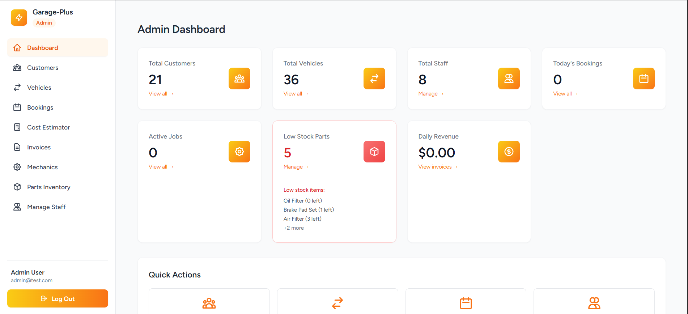
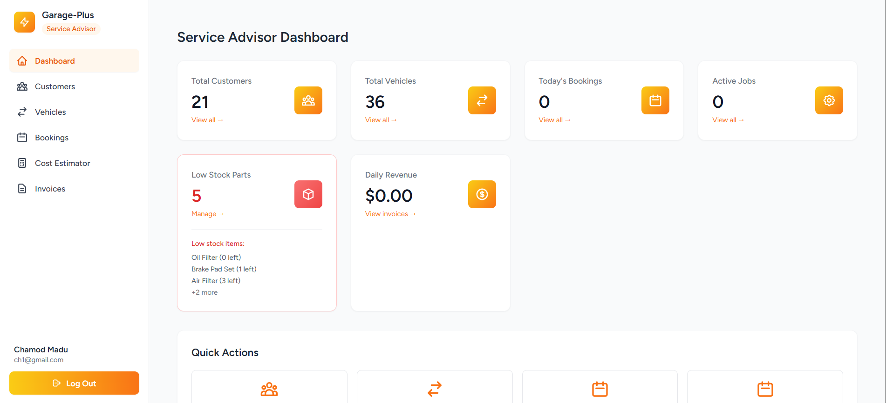
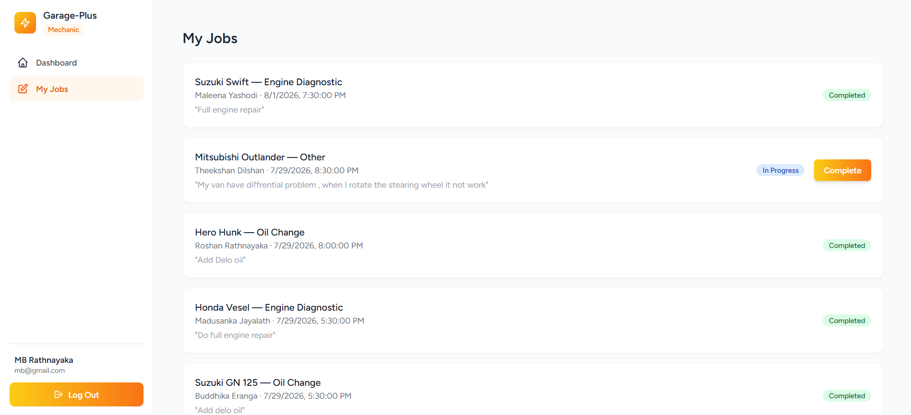
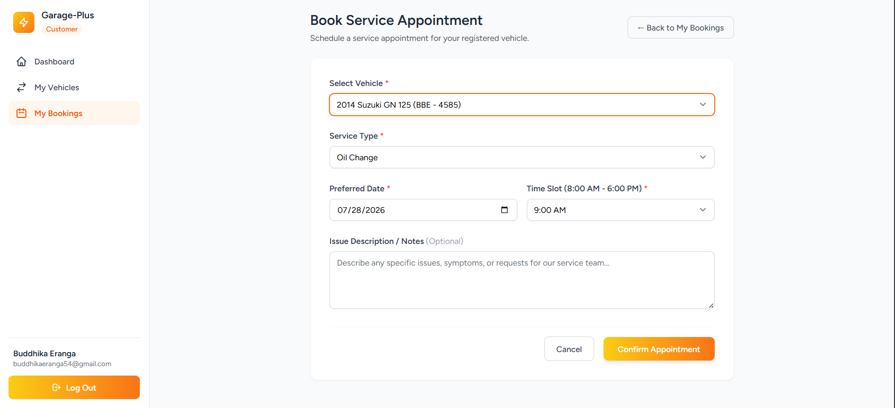
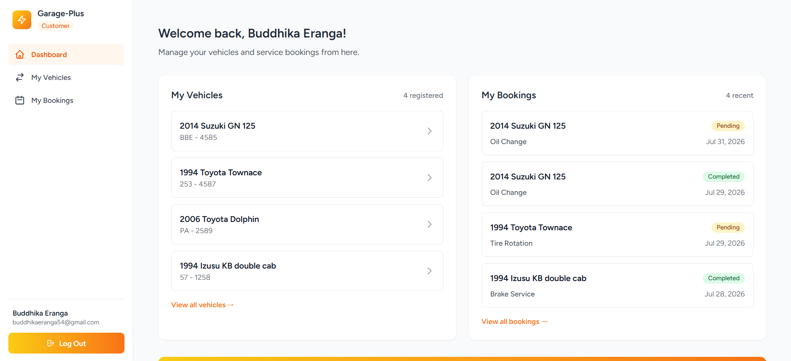
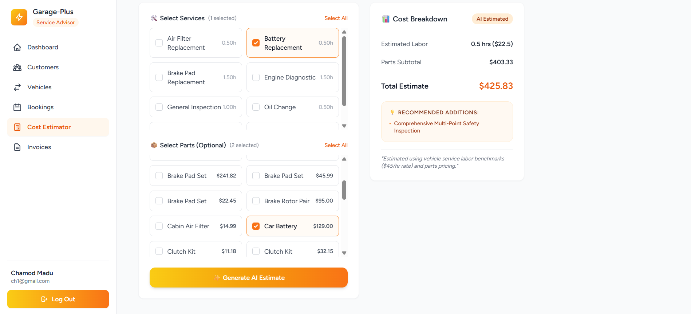
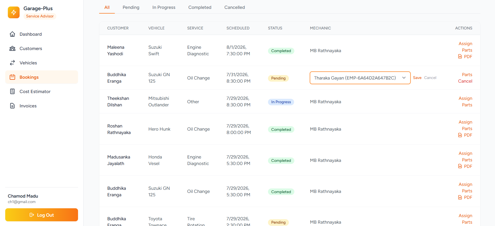
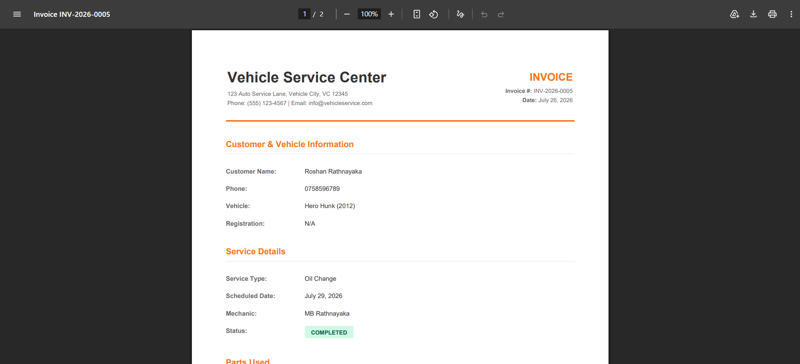
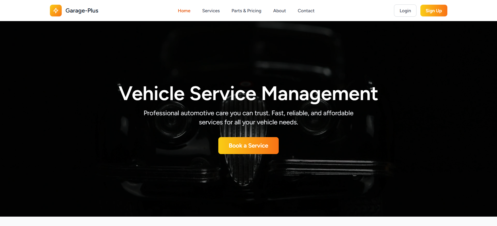

# Vehicle Service Management System

A full-stack web application for managing daily operations at a vehicle service center — customer & vehicle records, service bookings, mechanic assignment, parts inventory, job tracking, and invoicing — built as a 7-day internship assignment.

---

## Tech Stack

| Layer | Technology |
|---|---|
| Backend | Laravel 13 |
| Frontend | Inertia.js + React 19 |
| Styling | Tailwind CSS v4 |
| Database | PostgreSQL 16 (via Docker) |
| Authorization | Spatie Laravel Permission |
| AI Feature | AI Cost Estimator (Anthropic Claude API) |
| PDF Export | barryvdh/laravel-dompdf |
| Local Environment | Laravel Sail (Docker) |
| Version Control | Git |

---

## Features

### Core Functionality
- **Authentication & Role-Based Access Control** — Admin, Service Advisor, Mechanic, and self-registered Customer roles, each with distinct dashboards and permissions (via Spatie Laravel Permission)
- **Customer Management** — full CRUD (name, email, phone, address, notes)
- **Vehicle Management** — full CRUD, linked to customers (registration no., make, model, year, VIN, mileage)
- **Mechanic Management** — full CRUD (employee ID, specialization, contact), optionally linked to a login account
- **Service Booking & Job Cards** — appointment scheduling with double-booking prevention, job status workflow (Pending → In Progress → Completed → Cancelled)
- **Parts Inventory** — stock tracking with automatic deduction on job completion, low-stock alerts
- **Billing & Invoicing** — auto-generated invoice numbers, labor + parts cost calculation, payment status tracking, PDF export
- **Dashboard** — today's bookings, active jobs, low stock alerts, daily revenue summary (role-specific views)
- **Customer Self-Service Portal** — customers can register, add their own vehicles, book appointments, and download invoices for completed jobs
- **Public Marketing Pages** — Home, Services, Parts & Pricing, About, Contact (pre-login)

### AI Feature: AI Cost Estimator
Service advisors select services and parts for a job; the system calculates a real cost estimate from actual database prices, while Claude (Anthropic's API) suggests additional related services and flags unusual labor-hour estimates. The AI never determines the final price directly — all monetary calculations happen in PHP against real data, with the AI providing advisory suggestions only.

### Bonus Features Implemented
- [x] PDF Export (invoice download)
- [ ] Activity Log / Audit Trail
- [ ] Excel Export
- [ ] Email Notifications
- [ ] Calendar View
- [x] Docker Setup
- [ ] Unit Tests


---

## Screenshots

> - Admin Dashboard
> - Service Advisor Dashboard
> - Mechanic "My Jobs" view
> - Customer Dashboard
> - Booking creation form
> - Mechanic assignment on a booking
> - Generated invoice PDF
> - AI Cost Estimator result
> - Public Home page

```markdown
### Admin Dashboard


### Service Advisor Dashboard


### Mechanic My Job Flow


### Customer Booking Flow


### Customer Dasboard 


### AI Cost Estimator


### Mechanic Assign for Booking Flow


### Generated Invoice PDF


### Home Page

```

---

## Prerequisites

- [Docker Desktop](https://www.docker.com/products/docker-desktop/) (with WSL2 backend enabled, if on Windows)
- PHP 8.5+ and Composer (for the initial `composer install` before Sail exists)
- Node.js 18+ and npm
- An [Anthropic API key](https://console.anthropic.com) (for the AI Cost Estimator feature)

---

## Setup Instructions

### 1. Clone the repository

```bash
git clone <your-repo-url>
cd vehicle-service-management-system
```

### 2. Install PHP dependencies

```bash
composer install
```

### 3. Environment configuration

```bash
cp .env.example .env
```

Edit `.env` and confirm/set the following:

```env
DB_CONNECTION=pgsql
DB_HOST=postgres
DB_PORT=5432
DB_DATABASE=vehicle_service_management
DB_USERNAME=vehicle_service_user
DB_PASSWORD=vehicle_service_pass

ANTHROPIC_API_KEY=your_anthropic_api_key_here
```

### 4. Start Docker containers (Laravel Sail)

```bash
./vendor/bin/sail up -d
```

### 5. Generate application key

```bash
./vendor/bin/sail artisan key:generate
```

### 6. Run migrations and seed the database

```bash
./vendor/bin/sail artisan migrate:fresh --seed
```

This creates all tables and seeds:
- 3 staff test accounts (see **Test Accounts** below)
- ~15 sample customers with vehicles
- ~20 sample parts
- 8 common services

### 7. Install frontend dependencies

```bash
./vendor/bin/sail npm install
```

### 8. Build frontend assets

For development (with hot reload):
```bash
./vendor/bin/sail npm run dev
```

For a production build:
```bash
./vendor/bin/sail npm run build
```

### 9. Access the application

Visit **http://localhost** in your browser.

---

## Test Accounts

> **These are development/demo accounts only.**.

| Role | Email | Password |
|---|---|---|
| Admin | admin@test.com | password |
| Service Advisor | advisor@test.com | password |
| Mechanic | mechanic@test.com | password |

New customer accounts can be created via the public **Sign Up** page.

---

## Project Architecture

The application follows a layered architecture to keep controllers thin and business logic testable and reusable:

```
Request → Form Request (validation) → Controller → Service Class (business logic) → Model
                ↓
            Policy (authorization)
```

- **Form Requests** (`app/Http/Requests/`) — handle all input validation
- **Policies** (`app/Policies/`) — handle all authorization logic (who can do what)
- **Service Classes** (`app/Services/`) — contain business logic, wrapped in `DB::transaction()` where data integrity matters (e.g. booking conflict checks, stock deduction on job completion, invoice generation)
- **Controllers** — thin, orchestrate the above and return Inertia responses
- **Models** — Eloquent models with defined relationships and Laravel 13's attribute-based `#[Fillable]` casting

### Key business logic worth noting for reviewers

- **Double-booking prevention** (`BookingService::assignMechanic`) — uses `lockForUpdate()` inside a transaction to check for conflicting mechanic bookings within a time window before assignment.
- **Stock deduction & invoice generation** (`BookingService::updateStatus`) — when a job is marked "Completed," parts stock is deducted and an invoice is auto-generated **in a single atomic transaction** — if any part has insufficient stock, the entire operation rolls back and the booking status doesn't change.
- **Price snapshotting** — `booking_parts.unit_price` stores the part's price *at the time it was used*, not a live reference to `parts.unit_price`, so historical invoices stay accurate even if part prices change later.

---

## Database Schema (Simplified)

```
users ──┬── customers (1:1 via user_id)
        └── mechanics (1:1 via user_id)

customers ── vehicles (1:many)
customers ── bookings (1:many)
vehicles  ── bookings (1:many)
mechanics ── bookings (1:many)

bookings ── booking_parts ── parts (many:many, with quantity + price snapshot)
bookings ── invoices (1:1)

services (reference table for AI Cost Estimator + public Services page)
```

---

## Roles & Permissions

| Role | Access |
|---|---|
| **Admin** | Full system access — manage staff, mechanics, parts, all bookings |
| **Service Advisor** | Manage customers, vehicles, bookings, billing |
| **Mechanic** | View and update status of assigned jobs only |
| **Customer** | Self-registration, manage own vehicles, book/cancel own appointments, download own invoices |

---

## Known Limitations / Notes for Reviewers

- Labor cost is calculated using a simplified flat-rate model (`base_labor_hours × hourly_rate` per service); a production system would likely track actual time logged per job.
- The AI Cost Estimator degrades gracefully if the Anthropic API is unreachable — it falls back to base labor-hour estimates without AI suggestions rather than failing the request.
- Public parts/services images use placeholder URLs, not an uploaded-file system, to keep scope manageable within the assignment timeline.

---

## License

This project was built as an educational internship assignment and is not licensed for production/commercial use.